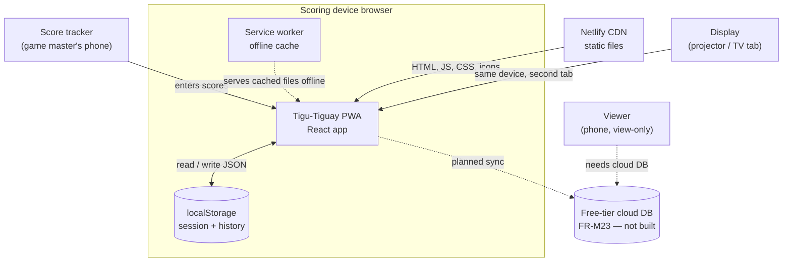
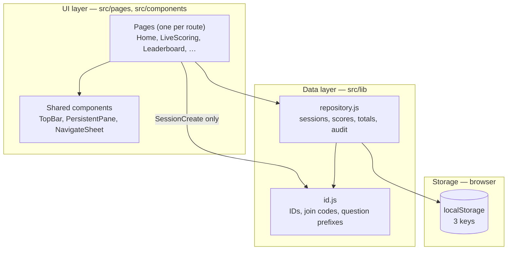
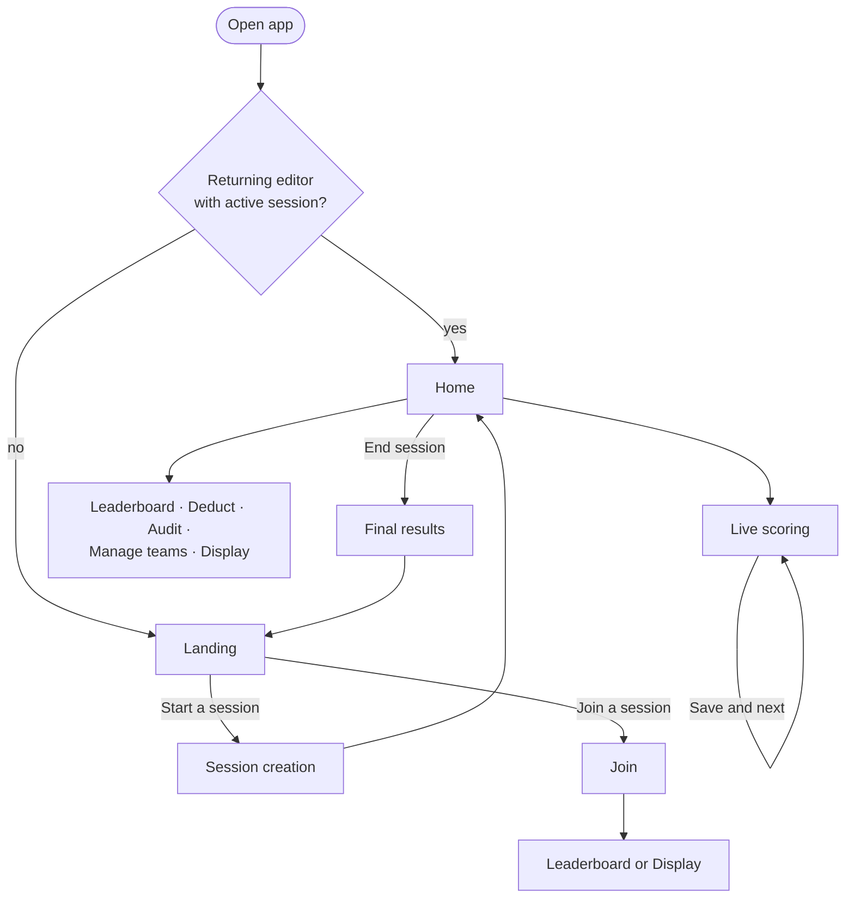
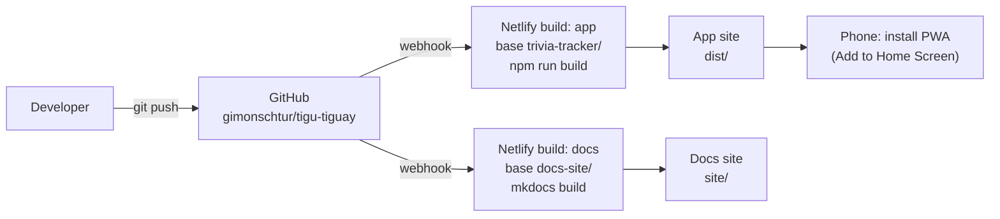
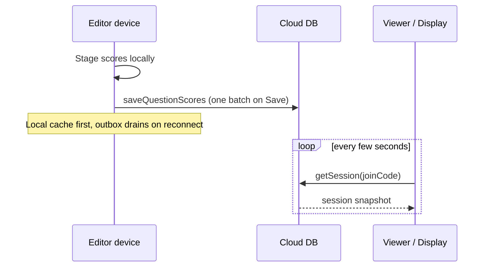

# Architecture

The score tracker is a static single-page app. Netlify serves the built
files; everything else, including all data, runs and lives in the browser of
the device that uses it.

## System context

Solid lines work today. Dashed lines need the cloud database (FR-M23):
until then, a viewer or display only works when it runs on **the same
device** as the score tracker, for example a second browser tab on a laptop
connected to a projector.

## Layers

The code has three layers. Pages never touch `localStorage` directly; they
go through the repository module, which is the single place that reads and
writes data.

| Layer | Responsibility | Rules |
|---|---|---|
| UI | Render screens, hold **staged** (unsaved) input in component state, navigate | No direct storage access; derive totals through the repository |
| Data | Create and end sessions, commit scores, compute totals, filter the audit trail | Pure functions over a session object, plus `load`/`save` helpers |
| Storage | Persist JSON | Three keys; see [Data model](data-model.md#storage-keys) |

The repository's function signatures are the seam for the planned backend:
swapping its internals for a cloud database leaves the UI unchanged.

## Runtime view

Every in-session screen re-reads the session from `localStorage` when it
mounts, so screens never hold stale shared state. Display mode also polls
every 2 seconds.

## Deployment

Both sites build from the same repository with separate base directories,
so code and docs ship from one commit. See
[Build, test, and deploy](build-test-deploy.md).

## Planned backend (FR-M23)

The chosen sync approach is lightweight polling against a free-tier cloud
database (design option C). Only the repository internals change.

Requirements still blocked on this work: FR-M10, FR-M19, FR-M23, FR-M39,
UX-M17, NFR-M01, and NFR-M04.

## Quality attributes

| Need | How the design meets it |
|---|---|
| No data loss on refresh or restart (NFR-M03) | Every commit writes the whole session to `localStorage` immediately |
| Fast entry under time pressure (UX-M27) | Large tap targets, one screen per question, all-teams button |
| Works with poor venue Wi-Fi (NFR-S02) | Service worker caches the app; no network calls at runtime |
| Correct totals after edits (FR-M11) | Totals derive from the audit trail; the latest entry per question wins |
| Low cost and effort (NFR-M07) | Static hosting, no server, free tiers only |
