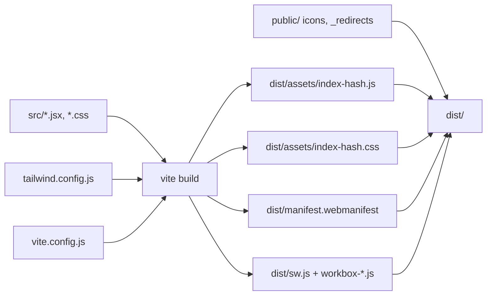
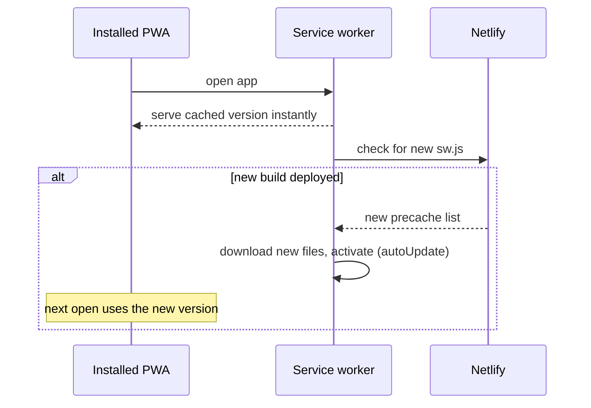

# Build, test, and deploy

## Local commands

Run from `trivia-tracker/` with Node 20 or newer.

| Command | Does |
|---|---|
| `npm ci` | Install exact dependency versions from `package-lock.json` |
| `npm run dev` | Dev server with hot reload at `http://localhost:5173` |
| `node tests/repository.test.mjs` | Data-layer tests (no browser needed) |
| `npm run lint` | oxlint |
| `npm run build` | Production bundle into `dist/` |
| `npm run preview` | Serve `dist/` locally to check the build |

Docs, from `docs-site/`:

| Command | Does |
|---|---|
| `pip install -r requirements.txt` | Install MkDocs Material |
| `mkdocs serve` | Live-reloading docs at `http://localhost:8000` |
| `mkdocs build --strict` | Build into `docs-site/site/`; fails on broken links |

## Tests

`tests/repository.test.mjs` runs the real `repository.js` against a mocked
`localStorage`, so it checks the logic every screen depends on.

| # | Covers |
|---|---|
| 1–5 | Scoring, corrections replacing originals, deductions, zero floor, unanswered questions (FR-M01–M03, FR-M11, FR-M13, FR-M18, FR-M22) |
| 6–7 | Audit filtering; no writes after a session ends (FR-M12, FR-M14) |
| 8–11 | Staged save, re-save as correction, unchanged values, per-team score vs correction (FR-M29, FR-M33) |
| 12 | Team renaming (FR-M28) |
| 13 | Category-derived question prefixes (FR-M34, FR-M35, FR-M37) |
| 14–16 | Zero corrections and their limits (FR-M32, FR-M50) |

UI behavior (staging, the all-teams toggle, banners) has no automated tests
yet; it is checked by hand or with a Playwright script at phone size
(390 × 844).

## Build pipeline

File names carry a content hash, so browsers never mix old and new code.

## Netlify sites

Both sites build from this repository; each has its own base directory and
config file.

| Site | Base directory | Config | Build | Publish |
|---|---|---|---|---|
| App | (repo root) | `netlify.toml` | `npm run build` in `trivia-tracker/` | `trivia-tracker/dist` |
| Docs | `docs-site` | `docs-site/netlify.toml` | `pip install -r requirements.txt && mkdocs build --strict` | `docs-site/site` |

To set up the docs site: in Netlify choose **Add new project → Import an
existing project → GitHub → tigu-tiguay**, set **Base directory** to
`docs-site`, pick the branch (`develop`), and deploy. Netlify reads
`docs-site/netlify.toml` for the rest.

!!! note "The live app site"
    `tigu-tiguay.netlify.app` was first deployed by uploading `dist/`. Link
    it to the repository (Project configuration → Build & deploy → Link
    repository) to deploy every push to `develop` automatically.

## How installed phones get updates

Scores in `localStorage` survive updates; only the app files change.
