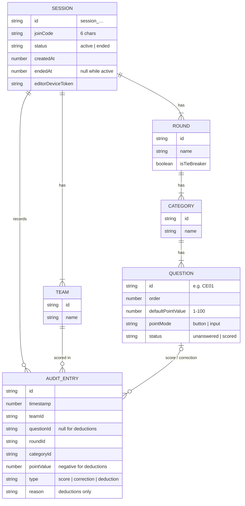
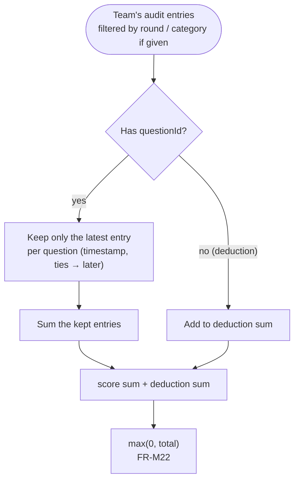
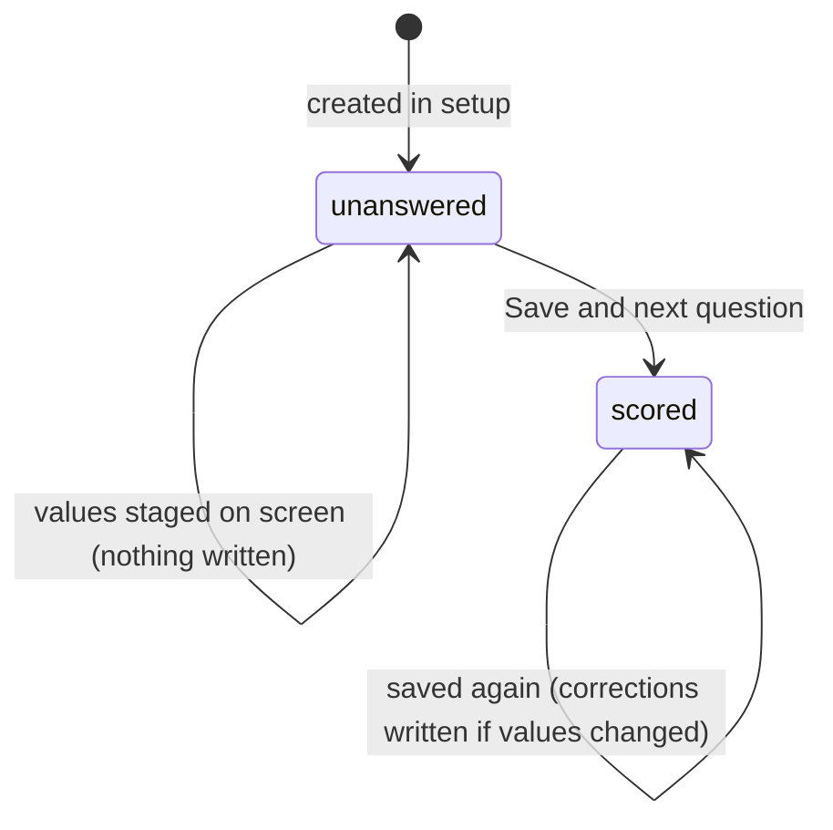
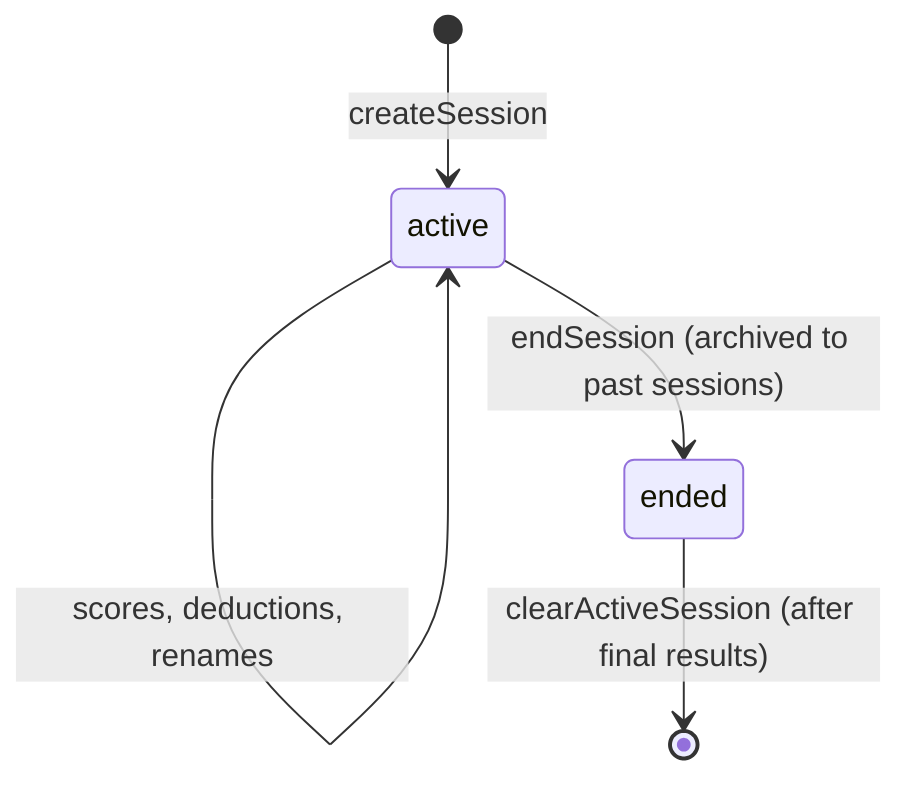
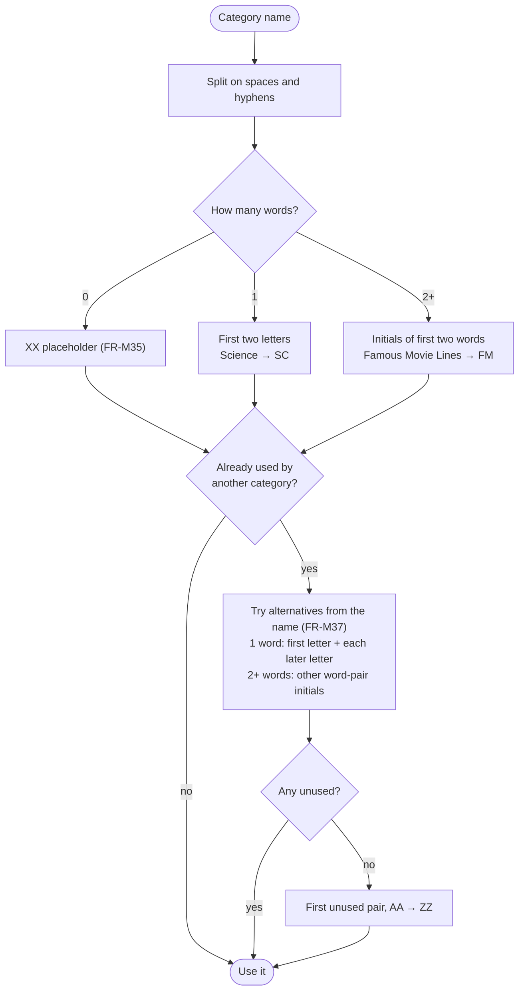

# Data model

A whole trivia night is one JSON **session** object. Scores are never
stored as totals: every change is an **audit entry**, and totals are worked
out from those entries whenever a screen needs them.

## Entities

Rounds, categories, questions, and teams are nested arrays inside the
session. Audit entries are a flat array (`session.auditEntries`) that
points back to them by ID.

## Storage keys

| Key | Value | Written by |
|---|---|---|
| `trivia_active_session` | The active (or just-ended) session | Every write function |
| `trivia_past_sessions` | Array of ended sessions, newest first | `endSession()` |
| `trivia_editor_token` | The token of the session this device created | `createSession()`; removed by `endSession()` |

Every write loads the session, changes it, and saves the **whole** object
back. There are no partial writes, so a closed tab can never leave a
half-saved question.

## Audit entry types

| Type | When | `questionId` | `pointValue` |
|---|---|---|---|
| `score` | A team's first saved value for a question | set | 1–100 |
| `correction` | A saved value replaces an earlier one | set | 0–100 (0 only per FR-M50) |
| `deduction` | A penalty from the Deduct screen | `null` | −1 to −100 |

Entries are never edited or deleted, so the audit trail is the full history
(FR-M12).

## How totals are computed

`getTeamTotal(session, teamId, { roundId?, categoryId? })`:

A correction therefore **replaces** the earlier score rather than adding to
it, and deductions stack.

## Question lifecycle

Only `saveQuestionScores` changes `status` (FR-M33). Saving a question with
nothing staged still marks it scored.

## Session lifecycle

Writes check `status === 'active'` and do nothing on an ended session
(FR-M14).

## Question IDs

Format: two letters from the category name plus a two-digit number within
the category, for example `CE01` for the first Current Events question
(FR-M08). `deriveCategoryPrefix(name, otherPrefixes)` picks the letters:

Renaming a category during setup re-derives its prefix and renumbers its
questions from 01 (FR-M36). Default rounds produce CE, SC, GE, PC, MA, HI,
FM, and NT with no collisions.
