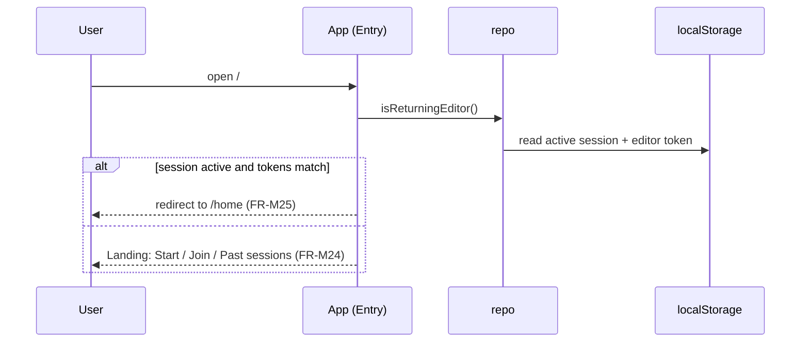
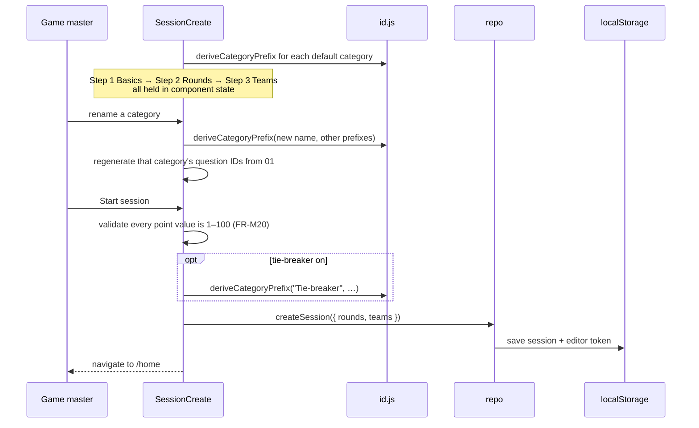
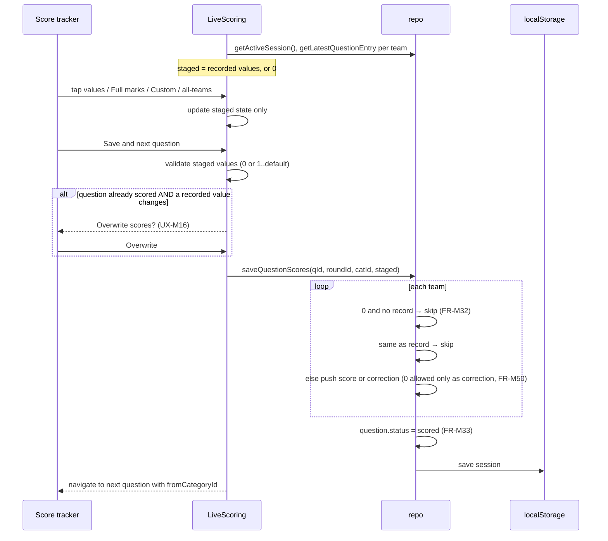
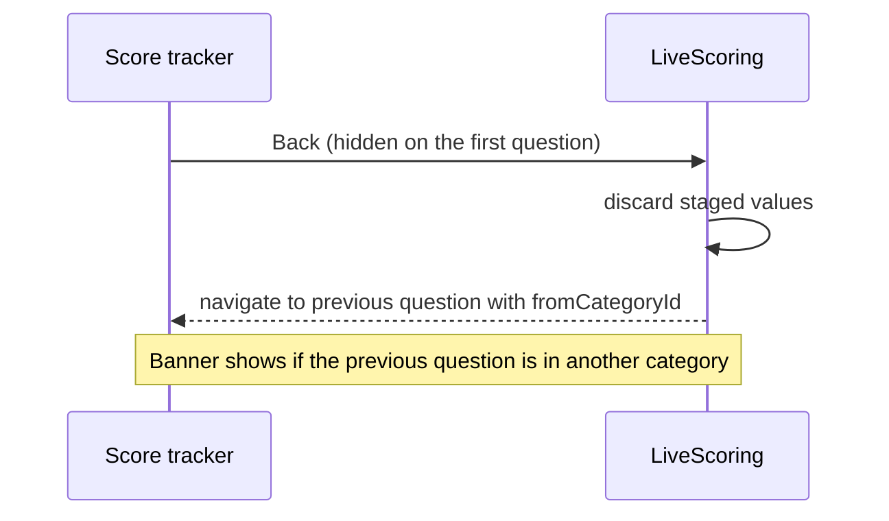
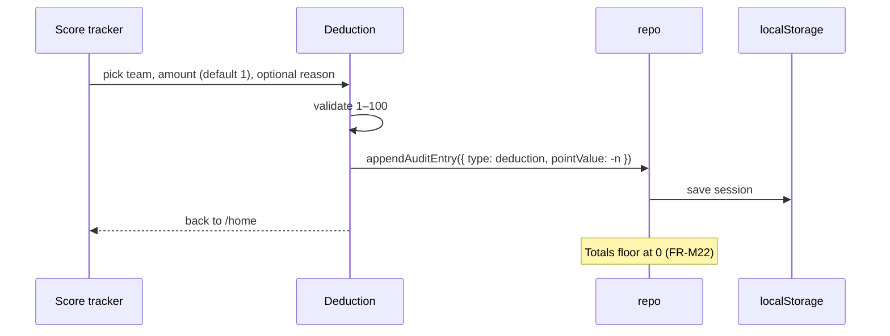
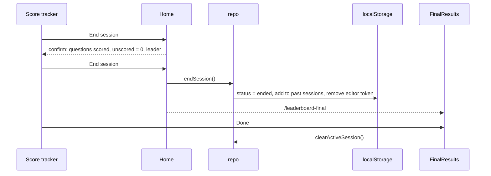
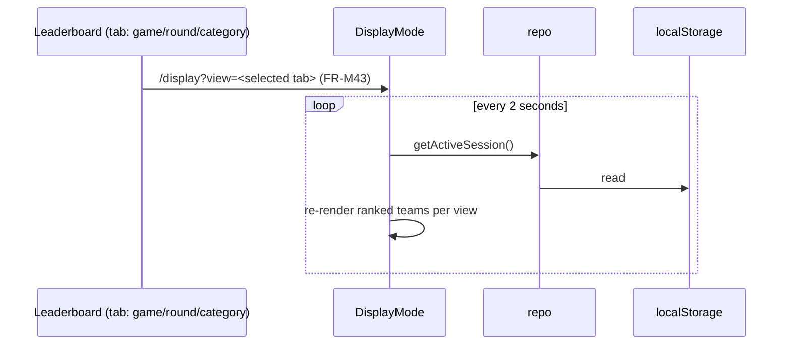
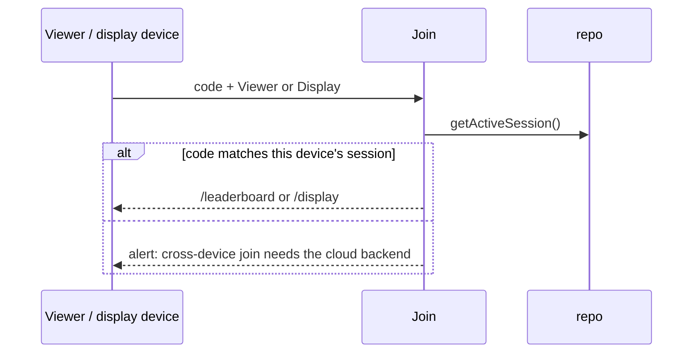

# Key flows

Sequence diagrams for the paths that matter most. `repo` is
`lib/repository.js`; `LS` is the browser's `localStorage`.

## Opening the app

## Creating a session

## Scoring a question

The core loop. Nothing is written until **Save and next question**
(FR-M29). Details of the on-screen states are in
[Live scoring in depth](live-scoring.md).

## Going back

## Deducting points

## Ending a session

## Display mode

A display in a second tab on the scoring device sees each save within
2 seconds. A display on another device needs the cloud database.

## Joining

