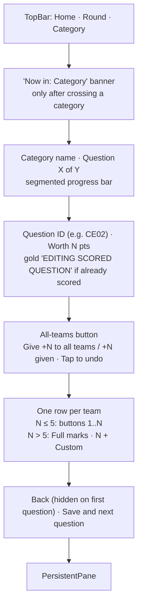
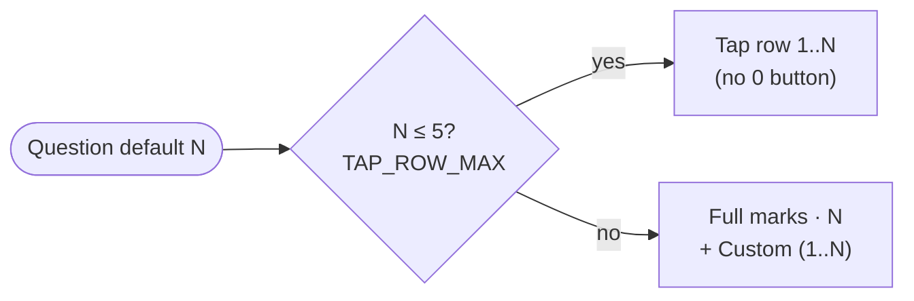
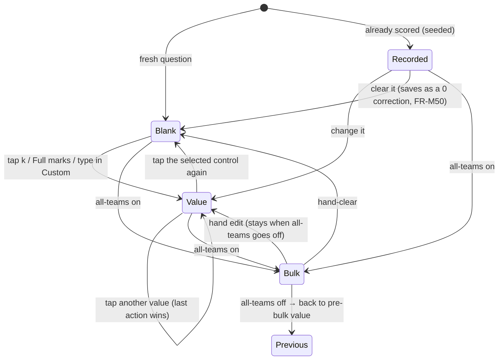
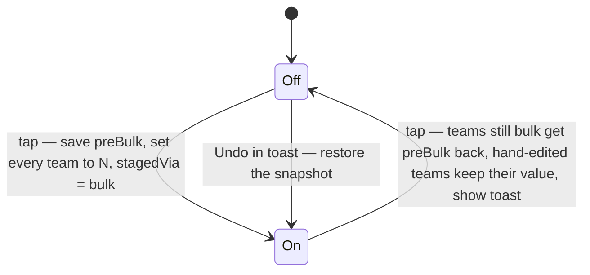

# Live scoring in depth

`pages/LiveScoring.jsx` is the most-used and most complex screen. This page
explains its state and rules so changes don't break scoring.

## Screen anatomy

## Component state

`LiveScoring` renders `LiveScoringInner` with `key={questionId}`, so every
piece of state below starts fresh on each question.

| State | Type | Meaning |
|---|---|---|
| `session` | object | Snapshot read on mount; refreshed after save |
| `staged` | `{ teamId: string }` | Each team's unsaved value; seeded from the latest recorded entry or `'0'` |
| `stagedVia` | `{ teamId: 'tap' \| 'quick' \| 'input' \| 'bulk' }` | Which control last set each team (FR-M31) |
| `customOpen` | `{ teamId: boolean }` | Custom input showing (>5-point questions) |
| `bulkOn` | boolean | All-teams button is on |
| `preBulk` | `{ teamId: string }` | Values from just before the all-teams button was turned on |
| `toast` | `{ message, undo }` | The undo message after turning all-teams off (4.5 s) |
| `errors` | `{ teamId: string }` | Inline validation messages |
| `showOverwriteConfirm` | boolean | Overwrite bottom sheet open |

## Which controls appear

There is no 0 button. A team with nothing selected saves as 0, and tapping
the control that holds a team's value clears it (FR-M30).

## One team's staged value

`Previous` is whatever the team held when the button was turned on: blank
on a fresh question, or its recorded value when editing.

## All-teams toggle

The toast names how many teams were reverted and which kept hand-entered
values (UX-M37).

## Save rules

| Staged | Recorded | Written | Rule |
|---|---|---|---|
| 0 | none | nothing | FR-M32 |
| 0 | 0 | nothing | unchanged |
| 0 | k > 0 | `correction` 0 | FR-M50 |
| k | none | `score` k | |
| k | k | nothing | unchanged |
| k | j ≠ k | `correction` k | |

The question becomes `scored` on every save, even if nothing was written.
Validation accepts 0 or a whole number from 1 to the question's default.

## Overwrite prompt

Shown only when the question is already `scored` **and** at least one team
with a recorded value would change (UX-M16). A team getting its first value
on a scored question does not trigger it. The gold "editing" label is
separate: it shows whenever the question is scored, change or not.

## Category banner and position

- **Position:** "Question X of Y" and a bar with one segment per question
  (current = espresso, scored = teal, others faded) (FR-M45).
- **Banner:** shown when `location.state.fromCategoryId` differs from this
  question's category, with a 60 ms vibration (FR-M46, UX-M33). Save and
  next and Back set that state; the Navigate sheet does not.
