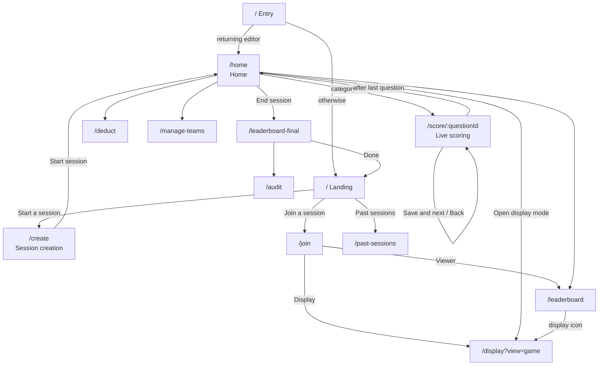
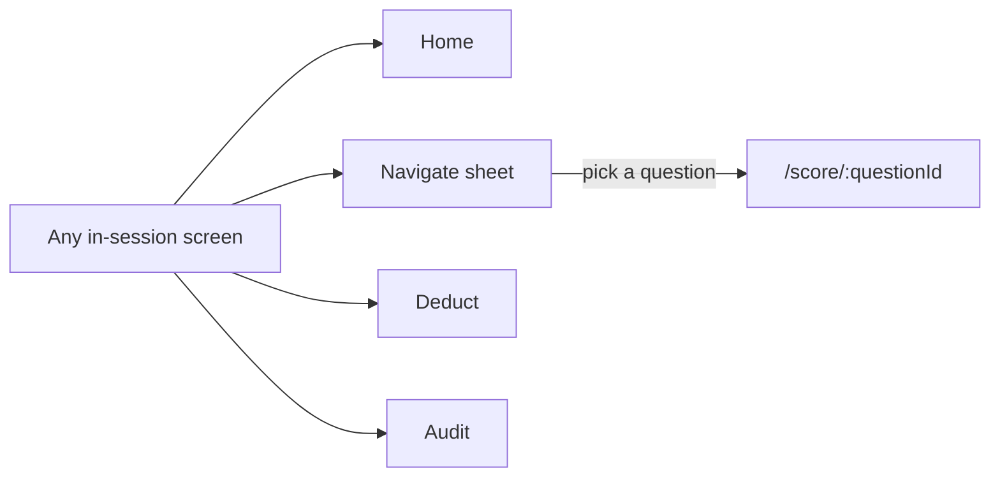

# Screens and navigation

The route table lives in `src/App.jsx`. All screens are client-side routes
under one `BrowserRouter`; Netlify's `_redirects` file sends every URL to
`index.html` so deep links and refreshes work.

## Route map

## Persistent pane

Home, Live scoring, Leaderboard, Deduction, and Audit trail share the
bottom pane (UX-M07), so these jumps are available from any of them:

The top bar on inner screens also always links back to Home (UX-M03).

## Routes

| Route | Screen | Pane | Reached from |
|---|---|---|---|
| `/` | Landing (or redirect to Home) | — | App open |
| `/create` | Session creation, 3 steps | — | Landing |
| `/join` | Join as Viewer or Display | — | Landing |
| `/past-sessions` | Ended sessions | — | Landing |
| `/home` | Home | ✔ | Setup, top bar, pane |
| `/score/:questionId` | Live scoring | ✔ | Home, Navigate sheet, Save/Back |
| `/leaderboard` | Leaderboard | ✔ | Home, Join (Viewer) |
| `/display?view=game\|round\|category` | Display mode | — | Leaderboard, Home, Join (Display) |
| `/deduct` | Deduction | ✔ | Home, pane |
| `/audit` | Audit trail | ✔ | Pane, Final results |
| `/manage-teams` | Manage teams | — | Home (pencil icon) |
| `/leaderboard-final` | Final results | — | End session |

## Navigation state

Live scoring passes `{ fromCategoryId }` in React Router's location state
when it moves with **Save and next** or **Back**. The next screen compares
it with its own category to decide whether to show the "Now in: …" banner
(FR-M46, UX-M33). Jumps from the Navigate sheet carry no state, so they
never show the banner.

Display mode reads its view from the `view` query parameter, which the
Leaderboard sets from its selected tab (FR-M43).
