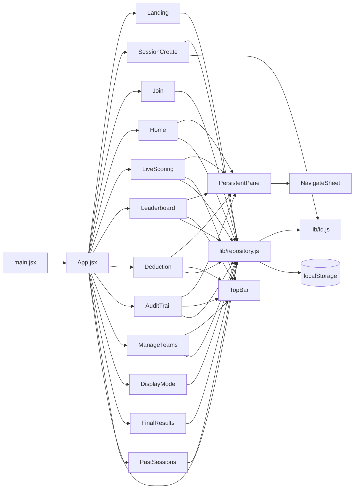
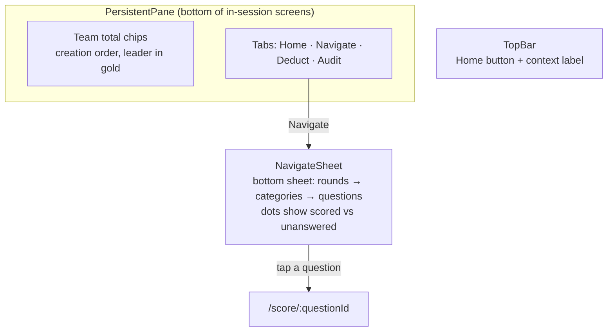

# Source code and components

## Repository layout

```text
tigu-tiguay/
├── trivia-tracker/          ← the app (Vite project)
│   ├── index.html           ← HTML shell, mounts #root
│   ├── vite.config.js       ← React + PWA plugins, web manifest
│   ├── tailwind.config.js   ← Barako Coastal color and font tokens
│   ├── public/              ← icons, favicon, _redirects (SPA fallback)
│   ├── src/
│   │   ├── main.jsx         ← React entry point
│   │   ├── App.jsx          ← route table
│   │   ├── index.css        ← Tailwind layers, fonts, base styles
│   │   ├── lib/
│   │   │   ├── repository.js← data layer (all storage access)
│   │   │   └── id.js        ← IDs, join codes, question prefixes
│   │   ├── components/      ← TopBar, PersistentPane, NavigateSheet
│   │   └── pages/           ← one component per route (12 pages)
│   └── tests/
│       └── repository.test.mjs ← Node tests for the data layer
├── dist/                    ← last production build (committed)
├── docs/                    ← this documentation (Markdown)
├── docs-site/               ← MkDocs config + Netlify settings for docs
├── mockups/                 ← original screen mockups (HTML)
└── netlify.toml             ← Netlify settings for the app
```

## Module dependencies

Arrows point from the importer to what it imports. Every page reaches
storage only through `repository.js`.



## Pages

| File | Route | Job | Repository calls |
|---|---|---|---|
| `Landing.jsx` | `/` | Start, join, or open past sessions | `getPastSessions` |
| `SessionCreate.jsx` | `/create` | 3-step setup: basics, rounds/categories/questions, teams | `createSession` |
| `Join.jsx` | `/join` | Enter a code, pick Viewer or Display | `getActiveSession` |
| `Home.jsx` | `/home` | Join code, teams, rounds with progress, end session | `getActiveSession`, `getLeaderboard`, `getTeamsInOrder`, `getAllQuestionsFlat`, `endSession` |
| `LiveScoring.jsx` | `/score/:questionId` | Stage and save one question's scores | `getActiveSession`, `getTeamsInOrder`, `getLatestQuestionEntry`, `getAllQuestionsFlat`, `saveQuestionScores` |
| `Leaderboard.jsx` | `/leaderboard` | Ranked totals by game, round, or category; opens Display | `getActiveSession`, `getLeaderboard`, `getTeamsInOrder`, `getTeamTotal` |
| `DisplayMode.jsx` | `/display?view=` | Dark projector leaderboard, polls every 2 s | `getActiveSession`, `getLeaderboard`, `getTeamTotal` |
| `Deduction.jsx` | `/deduct` | Apply a penalty immediately | `getActiveSession`, `getTeamsInOrder`, `appendAuditEntry` |
| `AuditTrail.jsx` | `/audit` | Filterable history of every change | `getActiveSession`, `getAuditEntries`, `getTeamsInOrder` |
| `ManageTeams.jsx` | `/manage-teams` | Rename teams mid-session | `getActiveSession`, `renameTeam` |
| `FinalResults.jsx` | `/leaderboard-final` | Final standings after ending | `getActiveSession`, `getLeaderboard`, `clearActiveSession` |
| `PastSessions.jsx` | `/past-sessions` | List of ended sessions and winners | `getPastSessions`, `getLeaderboard`, `getAllQuestionsFlat` |

## Shared components



| Component | Props | Notes |
|---|---|---|
| `TopBar` | `label` | Always offers a way back to Home (UX-M03) |
| `PersistentPane` | `session`, `teams`, `currentQuestionId?` | Satisfies UX-M07; shown on Home, Live scoring, Leaderboard, Deduction, Audit |
| `NavigateSheet` | `session`, `currentQuestionId`, `onClose` | Jumps straight to any question (UX-M04, UX-C01); does **not** trigger the category banner |

## Data layer API (`lib/repository.js`)

| Function | Writes? | Purpose |
|---|---|---|
| `createSession({ rounds, teams })` | ✔ | New active session, join code, editor token |
| `getActiveSession()` | | Read the active session (or `null`) |
| `isReturningEditor()` | | True if this device created the still-active session (FR-M25) |
| `saveQuestionScores(qId, roundId, catId, staged)` | ✔ | Commit one question's staged values in one batch; mark it scored |
| `appendAuditEntry(entry)` | ✔ | Single immediate write, used for deductions |
| `renameTeam(teamId, name)` | ✔ | Rename at any time during an active session |
| `endSession()` | ✔ | Lock the session, archive it to past sessions, drop the editor token |
| `clearActiveSession()` | ✔ | Remove the active session after viewing final results |
| `getPastSessions()` | | Archived sessions, newest first |
| `getTeamTotal(session, teamId, { roundId?, categoryId? })` | | Derived total; latest entry per question, floored at 0 |
| `getLeaderboard(session)` | | Teams sorted by total |
| `getTeamsInOrder(session)` | | Teams in creation order with totals (rows never jump) |
| `getAuditEntries(session, filters)` | | Filter by round, category, question, team; newest first |
| `getLatestQuestionEntry(session, qId, teamId)` | | The entry that currently counts for a team on a question |
| `getAllQuestionsFlat(session)` | | Every question in play order, with round and category names |

## `lib/id.js`

| Function | Purpose |
|---|---|
| `makeId(prefix)` | Random internal IDs such as `session_…`, `team_…`, `audit_…` |
| `makeJoinCode()` | 6-character code without look-alike characters (no I, O, 0, 1) |
| `makeCategoryQuestionId(prefix, index)` | `CE` + `01` → `CE01` |
| `deriveCategoryPrefix(name, otherPrefixes)` | Two-letter prefix from a category name with collision handling — see [Data model](data-model.md#question-ids) |

## Conventions

- **Requirement IDs in comments.** Code comments cite the requirement they
  implement (`// FR-M50: …`), so a search for an ID finds both the doc row
  and the code.
- **Read on mount.** Pages call `getActiveSession()` in a `useState`
  initializer and refresh after their own writes.
- **Stable row order.** Lists that you tap during scoring use
  `getTeamsInOrder`, never the sorted leaderboard, so rows never move under
  your finger.
- **Fresh state per question.** `LiveScoring` renders an inner component
  keyed by `questionId`, so all staged state resets on every question.
