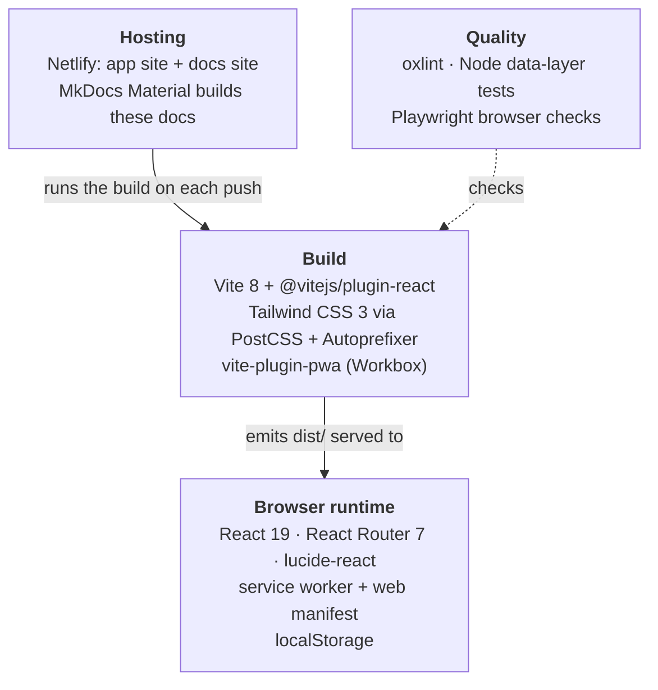

# Tech stack

All tools are free and open source (NFR-M07). Versions are the ranges in
`trivia-tracker/package.json`.

## Runtime libraries

| Package | Version | Job in this app |
|---|---|---|
| `react`, `react-dom` | ^19.2 | Components, state (`useState`, `useEffect`), rendering |
| `react-router-dom` | ^7.18 | `BrowserRouter`, route table in `App.jsx`, `useNavigate`, URL params, navigation state |
| `lucide-react` | ^1.41 | Outline icons (Home, Compass, Trophy, Users, MonitorPlay, …) |
| `vite-plugin-pwa` | ^1.3 | Generates `manifest.webmanifest` and a Workbox service worker (`registerType: autoUpdate`) |

## Build and quality tools

| Package | Version | Job |
|---|---|---|
| `vite` | ^8.2 | Dev server (`npm run dev`) and production bundle (`npm run build` → `dist/`) |
| `@vitejs/plugin-react` | ^6.1 | JSX transform and fast refresh |
| `tailwindcss` | ^3.4 | Utility classes; Barako Coastal colors in `tailwind.config.js` |
| `postcss`, `autoprefixer` | ^8.5, ^10.5 | Run Tailwind and add vendor prefixes |
| `oxlint` | ^1.79 | Linting (`npm run lint`), config in `.oxlintrc.json` |
| `playwright` | ^1.63 | Headless browser checks during development |

## Browser platform features

| Feature | Used for |
|---|---|
| `localStorage` | The active session, past sessions, and the editor token |
| Service worker + Cache Storage | Offline start and instant reloads |
| Web App Manifest | Home-screen install, standalone window, theme colors |
| `navigator.vibrate` | 60 ms buzz when a new category begins (where supported) |
| Google Fonts | Fraunces (display) and Manrope (body) |

## Design tokens

Defined once in `tailwind.config.js` and used as class names such as
`bg-espresso` and `text-teal`.

| Token | Hex | Meaning |
|---|---|---|
| `espresso` | `#3B2417` | Chrome: top bar, persistent pane |
| `cream` | `#F1E4D0` | Page background |
| `card` | `#FBF6EC` | Card surfaces |
| `teal` | `#1F7A72` | Add points, primary actions, "staged/on" state |
| `gold` | `#C98A2B` | Leader highlight, editing-scored-question badge, Custom entry |
| `coral` | `#D9714E` | Deductions, destructive actions, errors |
| `muted` | `#8A6A4A` | Secondary text |
